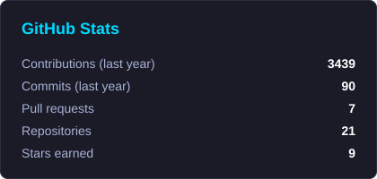
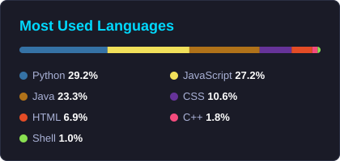

[🇧🇷 Português](README.md) · 🇺🇸 English

# Hi! I'm João Bremgartner 👋

## 🚀 About me

I'm a **Computer Engineer**, **senior developer** and **tech lead**. I build SaaS products and serverless systems on AWS end to end: from the Python and FastAPI backend to the React frontend, with all the infrastructure in Terraform.

- 💼 I lead engineering teams and own architecture, code and delivery
- ☁️ I enjoy event-driven architectures on AWS (Lambda, Step Functions, SQS, DynamoDB)
- 📊 Postgraduate degree in Data Science and Machine Learning (PUC-Campinas)
- 🔌 I also tinker with IoT: ESP32, Arduino and MQTT

Away from code, I play guitar 🎸, enjoy RPGs and strategy games 🎮, race on iRacing 🏎️ and work out to keep body and mind in shape 🏃‍♂️.

## 🌟 Featured projects

<table>
  <tr>
    <td width="170" align="center">
      
    </td>
    <td>
      
<b><a href="https://loteriassim.com.br">Loterias Sim</a></b> 
      Platform that suggests and simulates bets for Brazil's Mega-Sena, Lotofácil and Lotomania lotteries using statistical analysis of past draws. A fully serverless ecosystem on AWS.

      
Next.js · Python · Node.js · AWS Lambda · Step Functions · SQS · DynamoDB · Terraform

    </td>
  </tr>
  <tr>
    <td width="170" align="center">
      
    </td>
    <td>
      
<b><a href="https://beautyops.com.br">BeautyOps</a></b> 
      Management SaaS for event beauty professionals: from the first Instagram message to the final payment, with proposals, digitally signed contracts and Pix billing.

      
React · FastAPI · Aurora PostgreSQL · ECS Fargate · Cognito · Terraform

    </td>
  </tr>
  <tr>
    <td width="170" align="center">
      
    </td>
    <td>
      
<b>iRacing TMP</b> (private beta) 
      SaaS platform for sim racing teams: team management, telemetry, AI-assisted race strategy, setups and leagues.

      
React · TypeScript · FastAPI · AWS Lambda · Aurora PostgreSQL · Amazon Bedrock

    </td>
  </tr>
</table>

### Other projects

| Project | What it is | Stack |
|---------|---------|-------|
| [🎮 gamecal](https://github.com/engjoaofaro/gamecal) | Video game release calendar in the terminal | Python · Textual |
| [🌱 plantasense](https://github.com/engjoaofaro/plantasense) | Plant environment monitoring with ESP32 | C++ · ESP32 |
| [💧 irrigation-service-mqtt](https://github.com/engjoaofaro/irrigation-service-mqtt) | Smart irrigation with sensors and MQTT messaging | Python · MQTT |
| [✅ task-manager](https://github.com/engjoaofaro/task-manager) | Task management REST API | Java · Spring Boot |
| [📊 netflix_case_datacamp](https://github.com/engjoaofaro/netflix_case_datacamp) | Exploratory analysis of Netflix's 1990s movies | Python · pandas |

## 🛠️ Tech stack

### Languages

### Backend & Frontend

### Cloud, Data & DevOps

### IoT

## 📊 Stats

<picture>
  <source media="(prefers-color-scheme: dark)" srcset="https://raw.githubusercontent.com/engjoaofaro/engjoaofaro/output/stats-en-dark.svg" />
  <source media="(prefers-color-scheme: light)" srcset="https://raw.githubusercontent.com/engjoaofaro/engjoaofaro/output/stats-en-light.svg" />
  
</picture>
<picture>
  <source media="(prefers-color-scheme: dark)" srcset="https://raw.githubusercontent.com/engjoaofaro/engjoaofaro/output/langs-en-dark.svg" />
  <source media="(prefers-color-scheme: light)" srcset="https://raw.githubusercontent.com/engjoaofaro/engjoaofaro/output/langs-en-light.svg" />
  
</picture>

<a href="https://github.com/DenverCoder1/github-readme-streak-stats">
  <picture>
    <source media="(prefers-color-scheme: dark)" srcset="https://streak-stats.demolab.com/?user=engjoaofaro&theme=tokyonight" />
    <source media="(prefers-color-scheme: light)" srcset="https://streak-stats.demolab.com/?user=engjoaofaro&theme=default" />
    
  </picture>
</a>

## 🐍 Contributions

<picture>
  <source media="(prefers-color-scheme: dark)" srcset="https://raw.githubusercontent.com/engjoaofaro/engjoaofaro/output/github-contribution-grid-snake-dark.svg" />
  <source media="(prefers-color-scheme: light)" srcset="https://raw.githubusercontent.com/engjoaofaro/engjoaofaro/output/github-contribution-grid-snake.svg" />
  
</picture>

## 📫 Let's connect

---

⭐️ **"Music is the engineering of the soul, and code is the symphony of logic"** ⭐️

