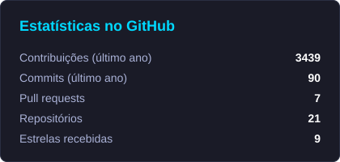
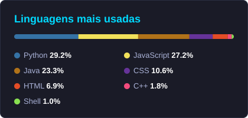

🇧🇷 Português · [🇺🇸 English](README.en.md)

# Olá! Eu sou João Bremgartner 👋

## 🚀 Sobre mim

Sou **Engenheiro de Computação**, **programador sênior** e **tech lead**. Construo produtos SaaS e sistemas serverless na AWS de ponta a ponta: do backend em Python e FastAPI ao frontend em React, com a infraestrutura toda em Terraform.

- 💼 Lidero times técnicos e cuido da arquitetura, do código e da entrega
- ☁️ Gosto de arquiteturas orientadas a eventos na AWS (Lambda, Step Functions, SQS, DynamoDB)
- 📊 Pós-graduado em Ciência de Dados e Machine Learning (PUC-Campinas)
- 🔌 Também me divirto com IoT: ESP32, Arduino e MQTT

Fora do código, toco guitarra 🎸, jogo RPGs e jogos de estratégia 🎮, corro no iRacing 🏎️ e treino para manter corpo e mente em dia 🏃‍♂️.

## 🌟 Projetos em destaque

<table>
  <tr>
    <td width="170" align="center">
      
    </td>
    <td>
      
<b><a href="https://loteriassim.com.br">Loterias Sim</a></b> 
      Plataforma que sugere e simula jogos da Mega-Sena, Lotofácil e Lotomania com análise estatística do histórico de sorteios. Ecossistema 100% serverless na AWS.

      
Next.js · Python · Node.js · AWS Lambda · Step Functions · SQS · DynamoDB · Terraform

    </td>
  </tr>
  <tr>
    <td width="170" align="center">
      
    </td>
    <td>
      
<b><a href="https://beautyops.com.br">BeautyOps</a></b> 
      SaaS de gestão para profissionais de beleza de eventos: da primeira mensagem no Instagram ao saldo pago, com propostas, contratos com assinatura digital e cobrança via Pix.

      
React · FastAPI · Aurora PostgreSQL · ECS Fargate · Cognito · Terraform

    </td>
  </tr>
  <tr>
    <td width="170" align="center">
      
    </td>
    <td>
      
<b>iRacing TMP</b> (beta privado) 
      Plataforma SaaS para equipes de sim racing: gestão de equipe, telemetria, estratégia de corrida com IA, setups e ligas.

      
React · TypeScript · FastAPI · AWS Lambda · Aurora PostgreSQL · Amazon Bedrock

    </td>
  </tr>
</table>

### Outros projetos

| Projeto | O que é | Stack |
|---------|---------|-------|
| [🎮 gamecal](https://github.com/engjoaofaro/gamecal) | Calendário de lançamentos de games no terminal | Python · Textual |
| [🌱 plantasense](https://github.com/engjoaofaro/plantasense) | Monitoramento ambiental de plantas com ESP32 | C++ · ESP32 |
| [💧 irrigation-service-mqtt](https://github.com/engjoaofaro/irrigation-service-mqtt) | Irrigação inteligente com sensores e mensagens MQTT | Python · MQTT |
| [✅ task-manager](https://github.com/engjoaofaro/task-manager) | API REST de gerenciamento de tarefas | Java · Spring Boot |
| [📊 netflix_case_datacamp](https://github.com/engjoaofaro/netflix_case_datacamp) | Análise exploratória de filmes da Netflix dos anos 90 | Python · pandas |

## 🛠️ Tecnologias

### Linguagens

### Backend & Frontend

### Cloud, Dados & DevOps

### IoT

## 📊 Estatísticas

<picture>
  <source media="(prefers-color-scheme: dark)" srcset="https://raw.githubusercontent.com/engjoaofaro/engjoaofaro/output/stats-pt-dark.svg" />
  <source media="(prefers-color-scheme: light)" srcset="https://raw.githubusercontent.com/engjoaofaro/engjoaofaro/output/stats-pt-light.svg" />
  
</picture>
<picture>
  <source media="(prefers-color-scheme: dark)" srcset="https://raw.githubusercontent.com/engjoaofaro/engjoaofaro/output/langs-pt-dark.svg" />
  <source media="(prefers-color-scheme: light)" srcset="https://raw.githubusercontent.com/engjoaofaro/engjoaofaro/output/langs-pt-light.svg" />
  
</picture>

<a href="https://github.com/DenverCoder1/github-readme-streak-stats">
  <picture>
    <source media="(prefers-color-scheme: dark)" srcset="https://streak-stats.demolab.com/?user=engjoaofaro&theme=tokyonight&locale=pt_BR" />
    <source media="(prefers-color-scheme: light)" srcset="https://streak-stats.demolab.com/?user=engjoaofaro&theme=default&locale=pt_BR" />
    
  </picture>
</a>

## 🐍 Contribuições

<picture>
  <source media="(prefers-color-scheme: dark)" srcset="https://raw.githubusercontent.com/engjoaofaro/engjoaofaro/output/github-contribution-grid-snake-dark.svg" />
  <source media="(prefers-color-scheme: light)" srcset="https://raw.githubusercontent.com/engjoaofaro/engjoaofaro/output/github-contribution-grid-snake.svg" />
  
</picture>

## 📫 Vamos conectar?

---

⭐️ **"A música é a engenharia da alma, e o código é a sinfonia da lógica"** ⭐️

